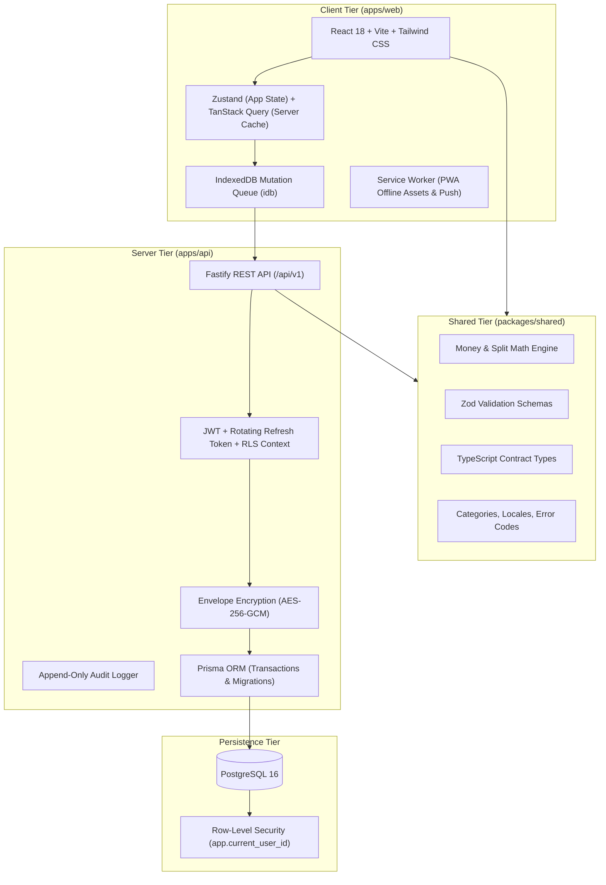
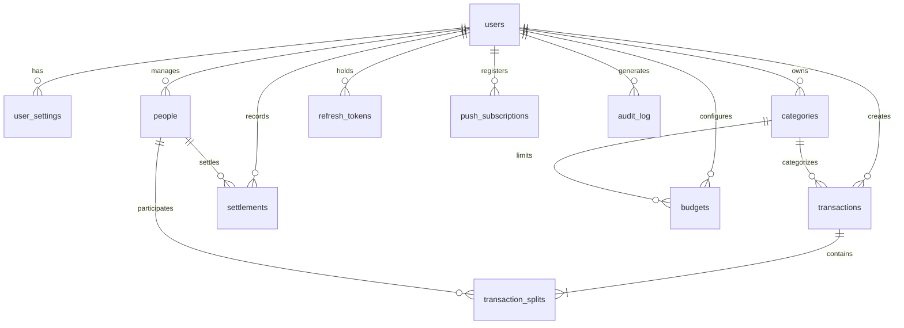
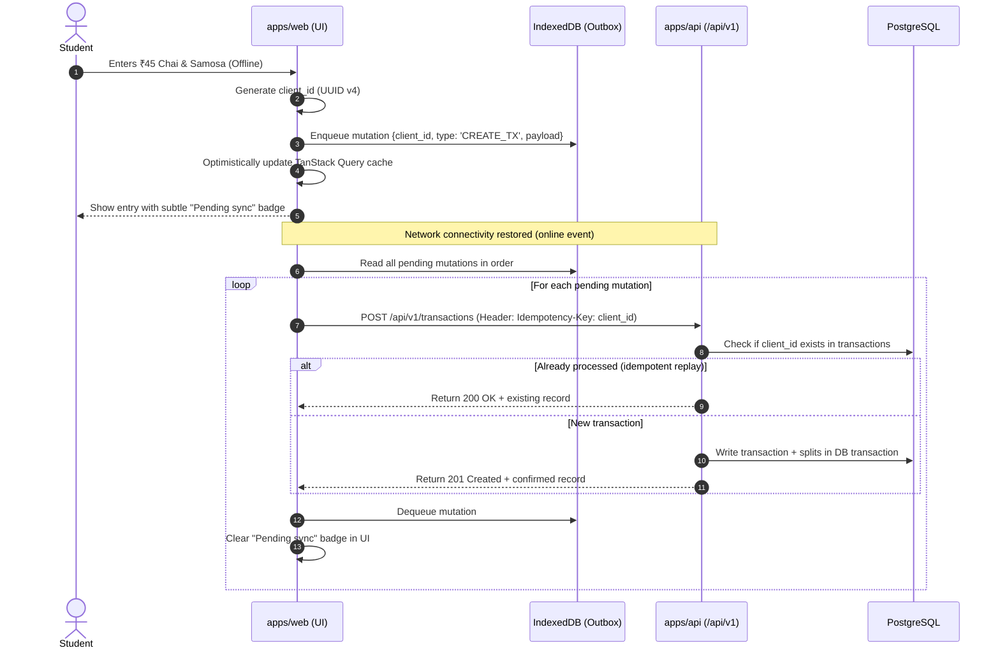

# Hisaab — Comprehensive Architectural & Engineering Plan (PLAN.md)

## 1. Executive Summary & Product Vision

**Hisaab** (हिसाब / Hisaab) is a high-craft, privacy-first personal expense tracker and shared ledger engineered specifically for Indian college students. 
Its design is grounded in the metaphor of a physical **campus notebook** ("Daylight paper" and "After-hours ink"), featuring warm paper surfaces, deep-teal ink, generous whitespace, and a calm, non-judgmental voice.

### Core Philosophy
1. **Privacy First**: Financial data belongs strictly to the student. Zero trackers, zero third-party analytics, self-hosted assets, field-level encryption at rest (AES-256-GCM) for notes and names, and one-click data export and permanent account deletion.
2. **Correctness Over Cleverness**: Money is stored exclusively as integer minor units (paise) with explicit ISO currency (`INR`). No floating-point math anywhere. Split remainders are deterministically distributed down to the exact paise. Balances are derived dynamically from immutable append-only ledger rows, never stored as mutable totals.
3. **Speed of Logging (< 10 seconds)**: Optimized single-handed numeric keypad, smart category and payment method defaults, inline friend selection, and instant offline queueing.
4. **Trilingual Fluency**: Seamless, reload-free switching between English, Hindi (हिन्दी), and Hinglish (Roman script Hindi), with layouts engineered to accommodate 30–40% longer Hindi text strings without truncation.

---

## 2. System Architecture & Tech Stack



### Stack Selection & Justifications
- **Monorepo**: `pnpm` workspaces for strict dependency isolation, blazing fast symlinking, and zero-overhead code sharing across web and API.
- **Frontend (`apps/web`)**:
  - **React 18 + Vite**: Lightning-fast HMR and lean production builds.
  - **Tailwind CSS**: Strict semantic token mappings for light ("Daylight paper") and dark ("After-hours ink") themes with zero runtime CSS-in-JS overhead.
  - **TanStack Query + Zustand**: Server state caching with persistence and a dedicated offline mutation queue in IndexedDB.
  - **React Hook Form + Zod**: High-performance, schema-driven validation matching shared backend schemas.
  - **Recharts**: Responsive SVG charts (spending trends, category donuts) customized with Hisaab's notebook palette.
  - **i18next**: Zero-reload locale switching with fallback chains (`hi` -> `en`, `hinglish` -> `en`).
- **Shared Package (`packages/shared`)**:
  - Single source of truth for paise calculation, split distribution algorithms, Zod request/response models, and constants. Guarantees client-side live previews match server execution to the paise.
- **Backend (`apps/api`)**:
  - **Fastify**: High-throughput, low-overhead Node.js/TypeScript framework with native JSON schema acceleration and built-in plugin architecture.
  - **PostgreSQL 16 + Prisma**: ACID transactions for multi-split ledger writes, robust migrations, and defense-in-depth Row-Level Security (RLS).
  - **Argon2id**: Memory-hard password hashing following OWASP recommendations (m=65536, t=3, p=1).
  - **AES-256-GCM Envelope Encryption**: Sensitive columns (`note_enc`, `friend_name_enc`, `phone_enc`) encrypted at rest using per-user Data Encryption Keys (DEKs) wrapped by a master Key Encryption Key (KEK).

---

## 3. Database Schema & Data Integrity



### Complete Table Definitions

#### 1. `users`
- `id` (UUID, PK, `gen_random_uuid()`)
- `email` (VARCHAR(255), UNIQUE, NOT NULL)
- `password_hash` (TEXT, NOT NULL)
- `dek_encrypted` (TEXT, NOT NULL) — User's Data Encryption Key encrypted with Server Master KEK
- `is_verified` (BOOLEAN, DEFAULT false)
- `two_factor_secret_enc` (TEXT, NULL) — TOTP secret encrypted with DEK
- `two_factor_enabled` (BOOLEAN, DEFAULT false)
- `created_at` (TIMESTAMPTZ, DEFAULT NOW())
- `updated_at` (TIMESTAMPTZ, DEFAULT NOW())
- `deleted_at` (TIMESTAMPTZ, NULL)

#### 2. `user_settings`
- `user_id` (UUID, PK, FK -> `users.id` ON DELETE CASCADE)
- `language` (VARCHAR(10), DEFAULT 'en') — 'en' | 'hi' | 'hinglish'
- `currency` (VARCHAR(3), DEFAULT 'INR')
- `theme` (VARCHAR(10), DEFAULT 'system') — 'light' | 'dark' | 'system'
- `reminder_time` (VARCHAR(5), DEFAULT '21:30') — HH:mm in 24h format
- `reminder_enabled` (BOOLEAN, DEFAULT true)
- `pin_hash` (TEXT, NULL) — Argon2id hash of 4-digit client PIN
- `pin_enabled` (BOOLEAN, DEFAULT false)
- `updated_at` (TIMESTAMPTZ, DEFAULT NOW())

#### 3. `people`
- `id` (UUID, PK, `gen_random_uuid()`)
- `user_id` (UUID, NOT NULL, FK -> `users.id` ON DELETE CASCADE)
- `name_enc` (TEXT, NOT NULL) — Encrypted friend name
- `phone_enc` (TEXT, NULL) — Encrypted optional phone number
- `notes_enc` (TEXT, NULL) — Encrypted friend note
- `avatar_color` (VARCHAR(16), NOT NULL) — Hex color for avatar initial background
- `created_at` (TIMESTAMPTZ, DEFAULT NOW())
- `deleted_at` (TIMESTAMPTZ, NULL)
- **Index**: `(user_id, deleted_at)`

#### 4. `categories`
- `id` (UUID, PK, `gen_random_uuid()`)
- `user_id` (UUID, NULL, FK -> `users.id` ON DELETE CASCADE) — NULL for global defaults
- `name` (VARCHAR(64), NOT NULL) — e.g. Food, Transport, Study, Shopping, Chai/Coffee, Rent, Entertainment, Other
- `icon` (VARCHAR(32), NOT NULL) — Lucide icon identifier
- `color` (VARCHAR(16), NOT NULL) — Hex color tag
- `is_default` (BOOLEAN, DEFAULT false)
- `created_at` (TIMESTAMPTZ, DEFAULT NOW())
- **Index**: `(user_id, is_default)`

#### 5. `transactions`
- `id` (UUID, PK, `gen_random_uuid()`)
- `client_id` (UUID, NOT NULL) — Client-generated UUID for offline idempotency
- `user_id` (UUID, NOT NULL, FK -> `users.id` ON DELETE CASCADE)
- `type` (VARCHAR(32), NOT NULL) — `personal` | `split` | `i_paid_for_someone` | `someone_paid_for_me`
- `payer_type` (VARCHAR(10), NOT NULL) — `me` | `person`
- `payer_person_id` (UUID, NULL, FK -> `people.id`) — If `payer_type == 'person'`
- `total_minor` (BIGINT, NOT NULL) — Amount in integer paise (e.g. ₹500.00 = 50000)
- `currency` (VARCHAR(3), DEFAULT 'INR')
- `category_id` (UUID, NOT NULL, FK -> `categories.id`)
- `payment_method` (VARCHAR(20), NOT NULL) — `cash` | `upi` | `card` | `transfer`
- `occurred_on` (DATE, NOT NULL) — Date of transaction (YYYY-MM-DD)
- `note_enc` (TEXT, NULL) — Encrypted note
- `split_mode` (VARCHAR(20), NULL) — `equal` | `exact` | `percentage`
- `version` (INTEGER, DEFAULT 1) — Incremented on edit
- `created_at` (TIMESTAMPTZ, DEFAULT NOW())
- `updated_at` (TIMESTAMPTZ, DEFAULT NOW())
- `deleted_at` (TIMESTAMPTZ, NULL)
- **Indexes**: `(user_id, occurred_on DESC)`, `(user_id, client_id UNIQUE)`, `(user_id, category_id)`, `(user_id, deleted_at)`

#### 6. `transaction_splits`
- `id` (UUID, PK, `gen_random_uuid()`)
- `transaction_id` (UUID, NOT NULL, FK -> `transactions.id` ON DELETE CASCADE)
- `participant_type` (VARCHAR(10), NOT NULL) — `me` | `person`
- `person_id` (UUID, NULL, FK -> `people.id`) — Populated if `participant_type == 'person'`
- `share_minor` (BIGINT, NOT NULL) — Exact paise owed or paid for this participant
- **Constraints**:
  - `CHECK ((participant_type = 'me' AND person_id IS NULL) OR (participant_type = 'person' AND person_id IS NOT NULL))`
- **Indexes**: `(transaction_id)`, `(person_id)`

#### 7. `settlements`
- `id` (UUID, PK, `gen_random_uuid()`)
- `client_id` (UUID, NOT NULL) — For idempotency
- `user_id` (UUID, NOT NULL, FK -> `users.id` ON DELETE CASCADE)
- `person_id` (UUID, NOT NULL, FK -> `people.id`)
- `direction` (VARCHAR(20), NOT NULL) — `they_paid_me` (reduces their debt) | `i_paid_them` (reduces my debt)
- `amount_minor` (BIGINT, NOT NULL) — Integer paise
- `payment_method` (VARCHAR(20), NOT NULL) — `cash` | `upi` | `card` | `transfer`
- `settled_on` (DATE, NOT NULL)
- `note_enc` (TEXT, NULL)
- `created_at` (TIMESTAMPTZ, DEFAULT NOW())
- `deleted_at` (TIMESTAMPTZ, NULL)
- **Indexes**: `(user_id, person_id)`, `(user_id, settled_on DESC)`

#### 8. `budgets`
- `id` (UUID, PK, `gen_random_uuid()`)
- `user_id` (UUID, NOT NULL, FK -> `users.id` ON DELETE CASCADE)
- `category_id` (UUID, NULL, FK -> `categories.id`) — NULL represents total monthly budget
- `month` (VARCHAR(7), NOT NULL) — Format: 'YYYY-MM'
- `limit_minor` (BIGINT, NOT NULL) — Integer paise
- `created_at` (TIMESTAMPTZ, DEFAULT NOW())
- `updated_at` (TIMESTAMPTZ, DEFAULT NOW())
- **Index**: `(user_id, month, category_id)` UNIQUE

#### 9. `audit_log`
- `id` (UUID, PK, `gen_random_uuid()`)
- `user_id` (UUID, NOT NULL)
- `entity_type` (VARCHAR(32), NOT NULL) — `transaction` | `settlement` | `person` | `budget`
- `entity_id` (UUID, NOT NULL)
- `action` (VARCHAR(16), NOT NULL) — `CREATE` | `UPDATE` | `SOFT_DELETE`
- `version` (INTEGER, NOT NULL)
- `diff_summary` (TEXT, NOT NULL) — Sanitized summary of changes (NO plaintext notes, passwords, or PII)
- `created_at` (TIMESTAMPTZ, DEFAULT NOW())
- **Index**: `(user_id, entity_type, entity_id)`

#### 10. `refresh_tokens`
- `id` (UUID, PK, `gen_random_uuid()`)
- `user_id` (UUID, NOT NULL, FK -> `users.id` ON DELETE CASCADE)
- `token_hash` (TEXT, NOT NULL) — SHA-256 hash of refresh token
- `family_id` (UUID, NOT NULL) — For rotation reuse detection
- `is_revoked` (BOOLEAN, DEFAULT false)
- `expires_at` (TIMESTAMPTZ, NOT NULL)
- `created_at` (TIMESTAMPTZ, DEFAULT NOW())
- **Index**: `(token_hash)`, `(family_id)`

#### 11. `push_subscriptions`
- `id` (UUID, PK, `gen_random_uuid()`)
- `user_id` (UUID, NOT NULL, FK -> `users.id` ON DELETE CASCADE)
- `endpoint` (TEXT, NOT NULL UNIQUE)
- `p256dh` (TEXT, NOT NULL)
- `auth` (TEXT, NOT NULL)
- `created_at` (TIMESTAMPTZ, DEFAULT NOW())

---

## 4. Money & Ledger Rules (Exact & Auditable)

### 4.1 Paise Integer Rule
- All amounts are stored, calculated, and exchanged as integer paise (`BigInt` in DB, `number` / integer in JSON).
- Example: `₹125.50` = `12550` paise. `₹1,25,000` = `12500000` paise.
- Currency formatting uses `Intl.NumberFormat('en-IN')` with the Indian digit grouping (e.g. `₹1,25,000`).

### 4.2 Split Math & Remainder Distribution
For a transaction with total $T$ minor units and $N$ participants:

1. **Equal Split**:
   - $\text{base} = \lfloor T / N \rfloor$
   - $\text{remainder} = T - (\text{base} \times N)$
   - Order participants deterministically: payer first, then by participant ID ascending.
   - Assign $\text{base} + 1$ to the first $\text{remainder}$ participants, and $\text{base}$ to the rest.
   - **Theorem**: $\sum \text{splits} \equiv T$ exactly. Not a single paise is created or lost.

2. **Exact Amounts**:
   - The user inputs exact integer amounts for each participant.
   - Validation rule: $\sum \text{exact\_shares} == T$ exactly. If not, the transaction cannot be saved and an inline validation error is shown.

3. **Percentage Split**:
   - Validation rule: $\sum \text{percentages} == 100.00\%$ exactly (basis points: $10000$).
   - Raw shares: $s_i = \lfloor (T \times \text{bps}_i) / 10000 \rfloor$.
   - Remainder: $R = T - \sum s_i$.
   - Distribute $R$ one paise at a time ordered by largest fractional remainder.

### 4.3 Ledger Balance Formulation
The net balance between User and Friend $P$ is computed directly from the ledger rows:

$$\text{NetBalance}(P) = \sum \text{OwedByFriend}(P) - \sum \text{OwedToFriend}(P) - \sum \text{SettlementsReceived}(P) + \sum \text{SettlementsPaid}(P)$$

Where:
- $\text{OwedByFriend}(P)$: Splits where Payer is 'me' and Participant is $P$.
- $\text{OwedToFriend}(P)$: Splits where Payer is $P$ and Participant is 'me'.
- $\text{SettlementsReceived}(P)$: Settlements where direction is `they_paid_me`.
- $\text{SettlementsPaid}(P)$: Settlements where direction is `i_paid_them`.

**Display Convention**:
- $\text{NetBalance} > 0$: **People owe you** (`#246E49` Green in light, `#A9DBAE` in dark)
- $\text{NetBalance} < 0$: **You owe** (`#AA483C` Coral in light, `#FFB6A5` in dark)
- $\text{NetBalance} == 0$: **Settled** (`#61726B` Muted in light, `#8BCAB0` in dark)

### 4.4 Personal Spending Calculation in Reports
Personal spending for a time period is strictly:
$$\text{MySpend} = \sum_{\text{Tx} \in \text{Period}} \text{Split}(\text{participant} = \text{'me'}).\text{share\_minor}$$
*Crucial Product Principle*: If the user pays ₹4,000 for dinner split 4 ways, their personal spend is ₹1,000, and ₹3,000 appears in "People owe you". Both figures are communicated with transparent visual distinction.

---

## 5. Screen Inventory & UX Mapping

### 5.1 Design-Provided Screens (From Figma PNGs)
1. **Home Dashboard (Light & Dark)**:
   - Header with Hisaab logo + greeting.
   - Quick Metric Card: "Spent today" (₹210, 3 personal · 1 split).
   - Ledger Cards: "People owe you" (₹1,450, green) & "You owe" (₹320, coral).
   - Recent Transactions list with category icon, title, split tag, and amount.
   - Empty state widget: "A fresh page for today" with "+ Add expense" CTA.
   - Language Switcher (English | हिन्दी | Hinglish).
   - Bottom navigation bar (Mobile) / Sidebar (Desktop).
2. **Add Expense Bottom Sheet / Modal (Light & Dark)**:
   - Centered amount display (`₹500`).
   - Contextual date ("Today at Campus Canteen").
   - Full custom 3x4 numeric keypad (1–9, ., 0, ⌫).
   - Primary action: "Save expense" / "खर्च जोड़ें" / "Kharcha add karo".
3. **Native Component Library**:
   - Buttons (Primary, Secondary, Tertiary in 3 languages, hover/focus/active/disabled).
   - Inputs (default, focused, filled, error state with validation message).
   - Filter chips & Segmented control pills.
   - Participant badge chips with avatar initials and remove/add icon.
   - Toasts (Success with Undo, Error alert).

### 5.2 Invented Screens (Engineered in Exact Matching Visual Language)
All invented screens strictly adhere to Hisaab's tokens (Warm paper canvas `#F7F6EF`, Surface `#FFFEFA`, 16px card radius, 12px control radius, 44px touch targets):

1. **Screen: Onboarding**
   - 3-step carousel:
     1. *Calm money, clear friendships*: Campus notebook, warm paper, room to breathe.
     2. *Split chai and dinner without friction*: Live split preview, exact down to the paise.
     3. *Private by design*: Encrypted notes, zero trackers, your data stays yours alone.
   - Bottom action: "Get Started" / "शुरू करें" and "Already have an account? Log in".
2. **Screen: Auth (Register / Login / Password Reset)**
   - Paper-styled card form with clean inputs.
   - Email & Password fields with live breach check indicator.
   - Google Sign-in alternative button.
   - Privacy guarantee banner: "We do not track you, sell your data, or serve ads."
3. **Screen: People Directory (`/people`)**
   - Summary bar: Total friends, Total receivable, Total payable.
   - Filter tabs: All | Owes me (Green) | I owe (Coral) | Settled (Muted).
   - Search input with instant client-side filtering.
   - Person list row: Avatar initial with tinted background, friend name, net balance pill, and chevron.
   - Quick FAB / Button: "+ Add friend".
4. **Screen: Person Detail (`/people/:id`)**
   - Large hero card displaying net balance with direction ("Rahul owes you ₹250" or "You owe Rahul ₹120").
   - Action duo:
     - **Settle Up** button (opens settlement bottom sheet).
     - **Remind** button: Generates a polite, friendly WhatsApp/SMS text (e.g. *"Hey Rahul! Quick heads-up: ₹250 is pending from our dinner on Hisaab. Whenever convenient!"*) with one-tap Copy/Share. (The app sends nothing autonomously).
   - Shared transaction timeline with running balance per entry.
5. **Screen: Settle Up Sheet / Modal (`/settle-up`)**
   - Mode selector: "They paid me" vs "I paid them".
   - Amount keypad with quick-tap chips: "Full amount (₹250)" | "Half (₹125)" | "Custom".
   - Payment method pill selector: Cash | UPI | Card | Transfer.
   - Date picker (default today) and optional note.
   - Settlement receipt preview and confirmation.
6. **Screen: History Ledger (`/history`)**
   - Full chronological feed grouped by date ("Today", "Yesterday", "17 Oct 2026").
   - Daily spend subtotal header for each group.
   - Search bar + Multi-filter drawer: Date Range, Categories, People, Payment Methods, Transaction Type.
   - Swipe actions (Mobile): Swipe left to Delete, Swipe right to Edit. Desktop: Action buttons on row hover.
   - Floating undo toast when an entry is deleted.
7. **Screen: Reports & Analytics (`/reports`)**
   - Date range selector: Today | This Week | This Month | Custom Range.
   - Personal Spend vs Shared Pass-through comparison card with explanatory tooltip.
   - Daily spending bar chart (highlighting days with peak expenses).
   - Category spending donut chart with percentage breakdown.
   - Top 5 spending categories and top 5 expenses.
   - "Export Report" button (Instant PDF summary or CSV data sheet).
8. **Screen: Budgets (`/budgets`)**
   - Overall monthly budget progress bar with color shifts (Green <80%, Amber 80–99%, Coral 100%+).
   - Category-specific budget cards with remaining daily allowance calculations.
   - In-app budget warning notification settings.
9. **Screen: Nightly Reminder & "Log Today" Mode (`/night-review`)**
   - Triggered at configured time (default 9:30 PM) or via top banner.
   - Distraction-free review of all transactions entered today.
   - Big prompt: "Did you buy chai or snacks after college?"
   - "+ Add missed expense" quick-button.
   - "All set for today! ✨" closing card with confetti/calm indicator.
10. **Screen: Settings & Privacy (`/settings`)**
    - Account profile section (Email, Change Password, 2FA TOTP status).
    - Preferences: Language (English / हिन्दी / Hinglish), Currency, Theme (Light / Dark / System).
    - Nightly reminder time picker.
    - Security: 4-digit App PIN Lock toggle.
    - Data Rights:
      - "Download My Data" (generates comprehensive ZIP containing JSON & CSV of all tables).
      - "Delete Account & Data" (danger zone: requires password re-authentication, executes cascade hard delete).
    - Plain-Language Privacy Policy (clear breakdown of encrypted fields and zero-telemetry architecture).

---

## 6. Security, Encryption & Privacy Specifications

### 6.1 Threat Model & OWASP Top 10 Mitigations
- **A01: Broken Access Control**: Every database query is strictly scoped by `WHERE user_id = :session_user_id`. Furthermore, PostgreSQL Row-Level Security (RLS) policies enforce data isolation at the engine level using `current_setting('app.current_user_id')`. Multi-user IDOR automated test suite verifies zero cross-tenant access.
- **A02: Cryptographic Failures**:
  - Encrypted fields (`note_enc`, `name_enc`, `phone_enc`) use AES-256-GCM with 96-bit random IVs and 128-bit authentication tags.
  - Envelope Encryption: Each user has a unique 256-bit Data Encryption Key (DEK). The DEK is encrypted using the server's Master Key (`APP_MASTER_KEY` via env/KMS) and stored in `users.dek_encrypted`.
  - Passwords hashed using Argon2id (`memory=64MB, iterations=3, parallelism=1`).
- **A03: Injection**: 100% parameterized SQL queries via Prisma ORM. Strict Zod schema validation strips unknown inputs.
- **A04: Insecure Design**: Append-only transaction versions with cryptographic hash audit log.
- **A05: Security Misconfiguration**: Strict Helmet HTTP headers:
  - `Content-Security-Policy`: `default-src 'self'; script-src 'self'; style-src 'self' 'unsafe-inline'; img-src 'self' data:; connect-src 'self'`
  - `Strict-Transport-Security`: `max-age=31536000; includeSubDomains; preload`
  - `X-Content-Type-Options: nosniff`
  - `X-Frame-Options: DENY`
- **A06: Vulnerable Components**: Pinned npm dependencies, regular audit scans.
- **A07: Identification and Authentication Failures**:
  - 15-minute access tokens in memory / authorization header.
  - 30-day refresh tokens stored in `httpOnly`, `Secure`, `SameSite=Lax` cookies with family reuse detection.
  - Offline breached password checking against the top 100,000 common passwords.
  - Rate limiting on `/auth/*`: 5 attempts per minute per IP with exponential lockout.
- **A08: Software and Data Integrity Failures**: Cryptographic idempotency keys on every transaction write prevent duplicate submissions.
- **A09: Security Logging & Monitoring Failures**: Structured JSON logging. Sensitive fields (passwords, notes, tokens, amounts, names) are strictly redacted in logging middleware.
- **A10: Server-Side Request Forgery (SSRF)**: The application makes zero external outbound HTTP requests.

---

## 7. Offline-First Architecture & Sync Protocol



### Conflict Resolution Strategy
- **Client-Generated UUIDs**: Every created transaction or settlement receives a client-side UUID (`client_id`).
- **Idempotency Guarantee**: If network drops during request transmission and the client retries, the server recognizes the `client_id` and safely returns the existing record without duplicate writes.
- **Last-Write-Wins (LWW) with Audit Trail**: If an edit conflicts, the latest timestamp wins, and an entry is recorded in the `audit_log` with an "OFFLINE_SYNC_MERGE" flag.

---

## 8. API Specifications (/api/v1)

All endpoints follow RESTful conventions under `/api/v1`, accept and return `application/json`, and return consistent error envelopes:
```json
{
  "error": {
    "code": "VALIDATION_ERROR",
    "message": "Split shares must equal total amount",
    "details": []
  }
}
```

### Core Endpoint Matrix

| Method | Endpoint | Description | Auth Required |
|---|---|---|---|
| `POST` | `/api/v1/auth/register` | Sign up with email & password | No |
| `POST` | `/api/v1/auth/login` | Authenticate & issue tokens | No |
| `POST` | `/api/v1/auth/refresh` | Rotate refresh token | Cookie |
| `POST` | `/api/v1/auth/logout` | Revoke current session | Yes |
| `POST` | `/api/v1/auth/logout-all` | Revoke all sessions across devices | Yes |
| `POST` | `/api/v1/auth/2fa/setup` | Generate TOTP secret & QR code | Yes |
| `POST` | `/api/v1/auth/2fa/verify` | Verify & enable TOTP | Yes |
| `GET` | `/api/v1/me` | Current user profile | Yes |
| `DELETE`| `/api/v1/me` | Hard delete account & all data | Yes (Password required) |
| `GET` | `/api/v1/me/export` | Download complete JSON/CSV export | Yes |
| `GET` | `/api/v1/settings` | Retrieve user preferences | Yes |
| `PATCH`| `/api/v1/settings` | Update language, currency, theme, PIN | Yes |
| `GET` | `/api/v1/categories` | List default & user categories | Yes |
| `POST` | `/api/v1/categories` | Create custom category | Yes |
| `GET` | `/api/v1/people` | List friends with net balances | Yes |
| `POST` | `/api/v1/people` | Create a friend | Yes |
| `GET` | `/api/v1/people/:id` | Friend details, balance, history | Yes |
| `PATCH`| `/api/v1/people/:id` | Update friend details | Yes |
| `DELETE`| `/api/v1/people/:id`| Soft delete friend | Yes |
| `GET` | `/api/v1/transactions` | Filtered, paginated transactions | Yes |
| `POST` | `/api/v1/transactions` | Create transaction (Idempotency Key) | Yes |
| `GET` | `/api/v1/transactions/:id` | Get single transaction | Yes |
| `PUT` | `/api/v1/transactions/:id` | Update transaction (creates new version)| Yes |
| `DELETE`| `/api/v1/transactions/:id`| Soft-delete transaction | Yes |
| `POST` | `/api/v1/settlements` | Record a settlement | Yes |
| `GET` | `/api/v1/balances` | Overall receivables & payables | Yes |
| `GET` | `/api/v1/reports/summary`| Period spending, trends, categories | Yes |
| `GET` | `/api/v1/reports/export` | Export PDF or CSV report | Yes |
| `GET` | `/api/v1/budgets` | Current month budget & alerts | Yes |
| `PUT` | `/api/v1/budgets` | Set overall or category budget | Yes |
| `POST` | `/api/v1/push/subscribe`| Register Web Push subscription | Yes |

---

## 9. Phased Implementation Roadmap

### Phase 1: Planning & Approval (Current Milestone)
- [x] Analyze Figma design sheets (`media_1792477299232_6410d44b.png` and `media_1792477296252_4401f575.png`).
- [x] Extract design tokens, typography, component inventory, and UI copy.
- [x] Define invented screens for missing flows.
- [x] Formulate mathematical models for paise money math and ledger balance resolution.
- [x] Draft `PLAN.md` and Design Analysis Artifact.
- [ ] **STOP & Await User Approval**.

### Phase 2: Monorepo Foundation & Core Libraries
- Scaffold `pnpm` monorepo structure (`apps/web`, `apps/api`, `packages/shared`, `docs/`).
- Setup Docker Compose (`postgres`, `api`, `web`) and `.env.example`.
- Build `packages/shared`:
  - Paise money math, rounding, split algorithms, currency formatting.
  - Comprehensive unit tests + fast-check property-based tests (100% split conservation).
  - Zod schemas for all models and API requests.
- Configure Tailwind CSS theme tokens matching Figma colors, typography, radii, and shadows in a single theme file.
- Build React base component library (Buttons, Inputs, Chips, Metric/Ledger Cards, Keypad, Toasts, Skeletons, Navigation).

### Phase 3: MVP — Auth, Add Expense, History, People & Settle Up
- Backend Fastify API with Prisma PostgreSQL migrations and RLS policies.
- Auth system: Argon2id password hashing, JWT access tokens, rotating refresh cookies, breached password check.
- Add Expense flow with custom numeric keypad, category picker, and live split preview.
- People list and Person detail with ledger balance resolution.
- Settle Up flow and settlement confirmations.
- History ledger with day groupings and soft-delete undo toast.
- Home dashboard integration in Light and Dark modes.
- Multi-viewport browser verification (390px, 768px, 1440px) with screenshots.
- **STOP & Await User Review**.

### Phase 4: Complete Feature Suite & Trilingual Polish
- Reports & Analytics with Recharts (daily bars, category donut, top 5 expenses).
- Budgets with 80% and 100% alert thresholds.
- Nightly reminder review flow ("Log Today").
- Offline sync engine via IndexedDB with pending sync indicators.
- CSV and PDF export generation.
- Settings: App PIN lock, 2FA TOTP, full data export, account deletion.
- Multilingual copy verification: English, हिन्दी, and Hinglish.

### Phase 5: Hardening, Security Review & Deployment Documentation
- Security audit against OWASP Top 10 checklist.
- Playwright E2E test suite across all 3 viewports.
- Lighthouse 90+ optimization pass (Performance, Accessibility, PWA).
- Finalize `SECURITY.md`, `README.md` (setup in under 10 minutes), and `DEPLOY.md`.
